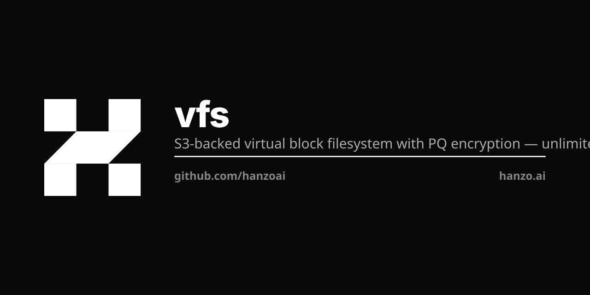

<p align="center"></p>

# vfs

[](https://hanzo.app/dev/open?repo=github.com/hanzoai/vfs&ref=main&action=open) [](https://hanzo.app/dev/open?repo=github.com/hanzoai/vfs&ref=main&action=edit) [](https://hanzo.app/dev/open?repo=github.com/hanzoai/vfs&ref=main&action=deploy)

A filesystem on an object store, sealed with a post-quantum key. A **Volume** is a
prefix of a bucket (or a directory): the engine behind a Hanzo Disk.

[]()
[]()

- **Content-defined chunks** of 64 KiB to 4 MiB (FastCDC), blake3-identified, each sealed on its own and packed into ~16 MiB objects. A small edit rewrites the chunks it touches; equal chunks are stored once.
- **Sharded metadata**: inodes, directory entries and chunk references are records in one Merkle tree of immutable shards. A commit writes the shards that changed and nothing else, and it scales to a million inodes. Files up to 16 KiB live inside the metadata.
- **One commit**: a single conditional PUT of a small `head` object. A crash at any point leaves the last committed tree, whole.
- **Fenced**: `Attach` claims the Volume at a monotone Round; a commit from an older Round is refused, and a takeover carries forward the last landed commit.
- **Sealed**: every object goes through a `Cipher`. The default is `luxfi/age` with a hybrid X25519 + ML-KEM-768 key. The engine never reads a key from a file or the environment, and seals each object to its Volume and place, so one copied in from elsewhere does not open.
- **Sparse**: a hole stores nothing. Truncating a file to a petabyte and writing a few bytes into it costs a few objects.

## Quick start

```bash
make build
./bin/vfs keygen > /tmp/vol.key                       # the Volume key (keep it in a secret store)
B=file:///tmp/vol                                      # or s3://bucket/prefix?endpoint=host:port
./bin/vfs init  --backend $B   < /tmp/vol.key
echo hello > /tmp/in.txt
./bin/vfs put   --backend $B --round 1 /tmp/in.txt /docs/hello.txt < /tmp/vol.key
./bin/vfs get   --backend $B /docs/hello.txt           < /tmp/vol.key
./bin/vfs ls    --backend $B /docs                     < /tmp/vol.key

make build-fuse && ./bin/vfs mount --backend $B --round 2 /mnt/vol < /tmp/vol.key
```

The key is read from standard input, one identity per line (the first seals new
objects, the others are retired keys that still open old ones). It is never an
argument, a file path or an environment variable. `--round` is the Round to claim
the Volume at; it must exceed the last one used.

## Library

```go
c := vfs.Hybrid(key)                                        // a key you hold
_ = vfs.Create(ctx, vfs.Config{Backend: be, Cipher: c})
v, _ := vfs.Attach(ctx, vfs.Config{Backend: be, Cipher: c, Round: 7})
f, _ := v.Create(ctx, vfs.RootInode, "a.txt", 0o644)
h, _ := v.Open(ctx, f.ID)
h.WriteAt(ctx, []byte("hello"), 0)
v.Flush(ctx)                                                // durable: head advanced in the store
```

`Flush` returns only after the Head naming everything written has advanced in the
store. `Fsync` is `Flush`.

Moving a Volume to another bucket or directory is a copy of its objects and `vfs.Reseal` of its Head: `vfs reseal --backend $NEW --round N [--from $OLD] < /tmp/vol.key`. It can be repeated at a higher round, and `--from` can be left out.

See [`docs/SPECIFICATION.md`](./docs/SPECIFICATION.md) for the on-disk layout and protocols as a third party could implement them, [`LLM.md`](./LLM.md) for the commit and fence protocols, and what
is not built yet, and [`docs/PRODUCTION-READINESS.md`](./docs/PRODUCTION-READINESS.md)
for the measurements.

Companion to [hanzoai/replicate](https://github.com/hanzoai/replicate) (SQLite WAL
to S3). Implements HIP-0107 through `replica/`.

## Testing

`vfs` test doubles (`internal/storetest`) use POSIX process/resource syscalls (`Setsid`, `Getrusage`), so run tests on Linux (or WSL2 on Windows) or macOS:

```bash
go test -race -short -count=1 ./pkg/... ./internal/blake3 ./internal/bufpool ./internal/storetest
go test -v -race -count=1 -run TestParaSync .
```

## License

Apache 2.0
